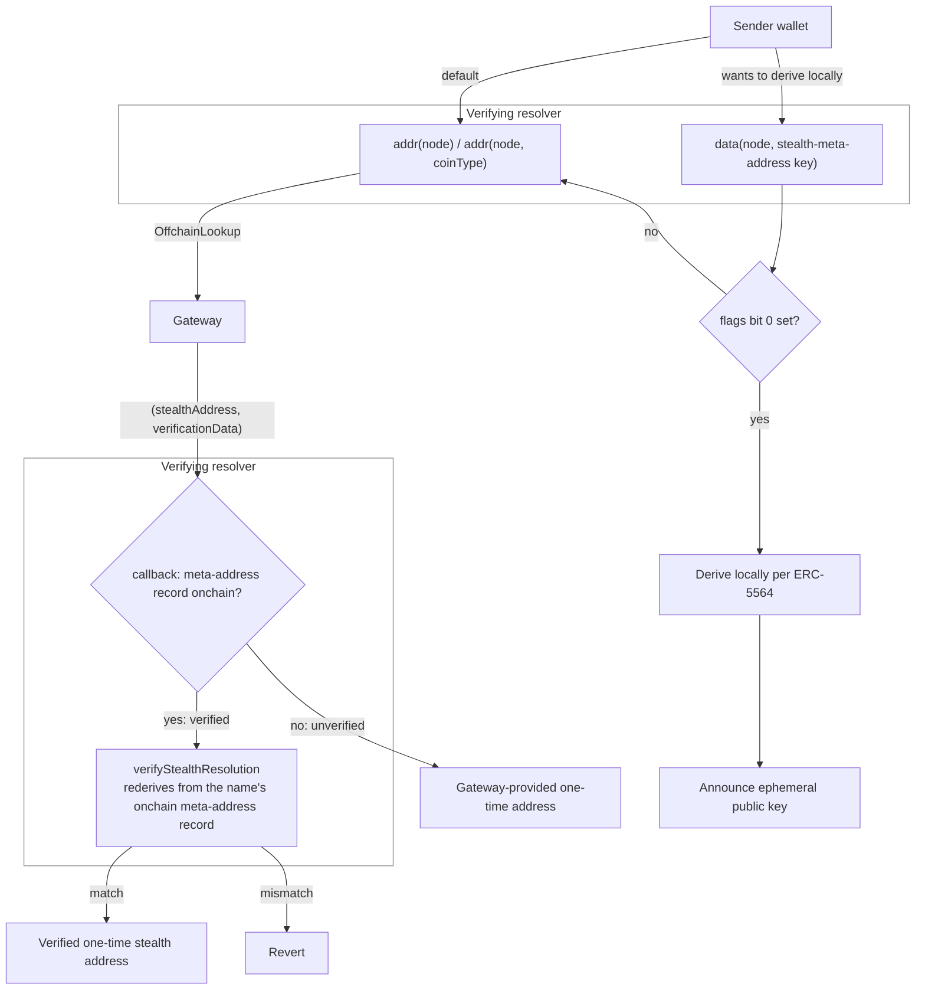

# ENSIP-30: Stealth Address Resolution

## Abstract

This ENSIP specifies how [ERC-5564](https://eips.ethereum.org/EIPS/eip-5564) stealth meta-addresses are published under ENS names, and the resolution semantics under which a name resolves to a fresh, one-time stealth address.

Two resolution paths are defined:
1. client-side derivation
2. gateway-based resolution via [ERC-3668](https://eips.ethereum.org/EIPS/eip-3668) (CCIP-Read) in which, for names that publish the meta-address record, every gateway-provided address is verified onchain against the registered meta-address before resolution completes

## Motivation

An ENS name typically resolves to a single static address, exposing the recipient's complete transaction and account history to anyone who looks the name up. Stealth addresses solve this by letting senders derive a new address for each payment from a published meta-address.

ENS names improve stealth address user experience by allowing for a single human readable identifier while returning a different address per resolution.

This ENSIP defines the standards that:
1. bind a stealth meta-address to an ENS name
2. make gateway-based stealth resolution verifiable onchain for names that publish a meta-address, so that a gateway can never return an address that does not derive from it

## Specification

The key words MUST, MUST NOT, SHOULD, and MAY are to be interpreted as described in [RFC 2119](https://www.rfc-editor.org/rfc/rfc2119).

### Overview

The two resolution paths, and where verification happens:



### 1. Meta-address record

The meta-address is published as an [ENSIP-24](https://docs.ens.domains/ensip/24) `data()` record.

**Key**

The record key is the following UTF-8 string:

```
stealth-meta-address[<schemeId>][<coinType>]
```

- `<schemeId>` is the ERC-5564 scheme ID, rendered as a decimal integer with no leading zeros and no `0x` prefix. `stealth-meta-address[1]` in any form other than `[1]` (e.g. `[01]`, `[0x1]`) is not a valid key.
- `<coinType>` is an [ENSIP-9](https://docs.ens.domains/ensip/9) coin type (for EVM chains, per [ENSIP-11](https://docs.ens.domains/ensip/11), with Ethereum as `60`), or the [ENSIP-19](https://docs.ens.domains/ensip/19) default coin type `2147483648` (`0x80000000`), rendered under the same decimal rule.

**Value**

The record value is raw bytes, composed of:
- a flag byte indicating whether client-side derivation (Section 2) is permitted. Bit 0 set means the recipient permits client-side derivation. Bit 0 clear means it does not, and clients MUST NOT derive locally. Bits 1 to 7 are reserved and MUST be zero.
- the scheme-defined meta-address encoding, as stored in [ERC-6538](https://eips.ethereum.org/EIPS/eip-6538). For scheme 1 this is the 33-byte compressed spending public key followed by the 33-byte compressed viewing public key, giving a 67-byte record value. The `st:<shortName>:` string form from ERC-5564 MUST NOT be used as the record value.

```
<client-side flag: 1 byte> || <meta-address bytes>
```

**Storage**

For a name to support verified gateway resolution (Section 4), the verifying resolver, located for the name per [ENSIP-10](https://docs.ens.domains/ensip/10), MUST serve this record via ENSIP-24 `data()` and MUST verify against exactly that value, obtained onchain within the verification call and independent of any gateway-supplied input. The value MUST NOT be obtained through ERC-3668. This applies equally to wildcard names whose other records are served offchain: the meta-address itself MUST be available onchain for verification. 

Because ENS allows one resolver per node, a verifying resolver SHOULD also implement the standard resolver profiles (address, text, contenthash) so that names can adopt it without losing existing records.

**Rotation**

Exactly one value exists per `(schemeId, coinType)`. Rotation is performed by overwriting the record; concurrent values are not supported.

**Failure semantics**

A record that is absent, malformed (wrong length or encoding for its scheme), or of an unsupported scheme MUST be treated as if the name does not support client-side derivation for that scheme. Clients MUST NOT derive stealth addresses from partial or malformed data.

### 2. Capability discovery

A name may support client-side derivation, gateway-based resolution, or both. The record carries the recipient's policy, and its presence selects whether gateway-based resolution is verified (Section 4). Gateway availability is a property of the verifying resolver, per name and coin type. The resolver stores a list of gateway URLs for each name, exposed via `gatewayURLs(node)` (Section 5), and the set of coin types enabled for gateway resolution. A non-empty list means gateway-based resolution is configured for the name on its enabled coin types. Other coin types follow the no-gateway rule of Section 4.

| | no record | flags bit 0 clear | flags bit 0 set |
|---|---|---|---|
| **gateway URLs set, coin type enabled** | gateway only (unverified) | gateway only (verified) | both (gateway verified) |
| **no gateway, or coin type not enabled** | static `addr()` | static `addr()`, or misconfigured if unset | client-side only |

A sending client proceeds as follows:

- A client that accepts gateway-based resolution MAY simply call `addr()` (or the chain-specific address record) without reading the meta-address record. A verifying resolver (implementing the interface in Section 5) returns a one-time address per Section 4; a name without a gateway returns whatever the owner has set, or nothing. This is the path taken by wallets unaware of this ENSIP. A client that wishes to know whether a name's resolver supports stealth addresses MAY check the resolver's ERC-165 support for the interface in Section 5, whether gateway-based resolution is configured for the specific name by checking that `gatewayURLs(node)` is non-empty, whether the target coin type is enabled for gateway resolution (the address query reverts with `OffchainLookup` if so and returns the static record otherwise), and whether it is verified by checking that the Section 1 record exists for the target coin type.
- A client that wishes to derive locally MUST first read the meta-address record per Section 1 for the target chain's coin type. If the record is absent or malformed, the name does not support client-side derivation on that chain. If flags bit 0 is set, the client MAY derive locally per Section 3. If flags bit 0 is clear, the client MUST NOT derive locally and falls back to `addr()`.
- If the record exists with flags bit 0 clear and `addr()` returns nothing, the name is misconfigured; the client MUST surface an error and MUST NOT derive locally.

Clients MUST NOT derive locally when flags bit 0 is clear, even though the public meta-address makes derivation possible: the recipient has signalled that it does not detect such payments.

### 3. Client-side resolution

Where permitted by the record's flags (Section 2), a sending client MAY resolve stealth addresses without any gateway:

1. Read the meta-address record per Section 1 for the target chain's coin type.
2. Generate an ephemeral keypair locally.
3. Derive the stealth address, ephemeral public key, and view tag per ERC-5564 for the record's scheme.
4. After sending the payment, publish the ERC-5564 announcement (stealth address, ephemeral public key, and view tag) so the recipient can detect it.

This ENSIP adds no new interface for this path. It specifies only which record to read and how to parse it.

### 4. Gateway-based resolution

Only EVM coin types ([ENSIP-11](https://docs.ens.domains/ensip/11)) and the ENSIP-19 default coin type can be enabled for gateway resolution. Address records for other coin types, and for coin types not enabled, follow the no-gateway rule below, even when the default is enabled: enabling it applies to queries for the default coin type only. For the enabled coin types of a name with a non-empty `gatewayURLs(node)`, a verifying resolver resolves `addr()` (and chain-specific address records) via ERC-3668, through ENSIP-10 `resolve()`:

1. The resolver reverts with `OffchainLookup`, directing the client to `gatewayURLs(node)` (Section 5). The `callData` of the revert is the `resolve(name, data)` call being answered. The resolver sets `extraData` such that the callback can recover at least the name and the `coinType` of the requested address record; `node` follows from the name.

2. The gateway generates an ephemeral keypair, derives the stealth address from the name's meta-address, and returns the ABI-encoded response payload:

```solidity
(address stealthAddress, bytes verificationData)
```

`verificationData` is defined by the specification of each scheme (Section 5). In unverified mode, `verificationData` is implementation-defined.

3. The client invokes the resolver's callback per ERC-3668. The callback MUST recover the `node` and `coinType` from `extraData` and decode the response payload. It then proceeds according to whether the name has a meta-address record (Section 1) for the resolver's scheme and the recovered `coinType`, read onchain within the callback and not inferred from `extraData` or the response:

   - **Verified** (record present): the callback MUST enforce verification with semantics identical to `verifyStealthResolution` (Section 5): it MUST recompute the stealth address derivation from the name's onchain meta-address record and the supplied `verificationData`, and MUST revert unless the result equals `stealthAddress`. Implementations SHOULD implement the callback's verified mode as a thin wrapper over `verifyStealthResolution`.
   - **Unverified** (record absent): the callback returns `stealthAddress` without re-derivation. Any checks on `verificationData` are implementation-defined; they MAY authenticate the gateway (e.g. signed responses, as ENS offchain resolvers do today), but do not constitute verification in the sense of this ENSIP.

In verified mode, because ERC-3668 requires the callback to execute before any value is returned, resolution structurally cannot return an unverified address. Verification runs inside the sender's own `eth_call`; it adds no gas to the subsequent payment, and the ephemeral secret is never broadcast.

For a name with no gateway URLs, and for any coin type not enabled for gateway resolution, the resolver MUST return the conventional address record if one is set, or follow standard ENS semantics for an unset record (e.g. `addr()` returns the zero-length/zero address), rather than reverting, so that stealth-enabled and conventional names coexist on the same resolver. Reverts are reserved for failed verification and failed implementation-defined checks (step 3). Where the verifying resolver forwards these queries to another resolver, that resolver's failures MAY propagate.

Wallets unaware of this ENSIP receive one-time addresses transparently through this path via ordinary ERC-3668-compliant resolution.

### 5. Verifying resolver interface

```solidity
interface IStealthResolver {
    /// @notice The single ERC-5564 scheme this resolver verifies.
    function schemeId() external view returns (uint256);

    /// @notice Gateway URLs used for ERC-3668 resolution of `node`.
    /// @return An empty array if gateway-based resolution is not configured for `node`.
    function gatewayURLs(bytes32 node) external view returns (string[] memory);

    /// @notice Verifies that `stealthAddress` derives from the meta-address
    ///         registered for `node` and `coinType` under this resolver's scheme.
    /// @return stealthAddress on success; reverts on mismatch or missing record.
    function verifyStealthResolution(
        bytes32 node,
        uint256 coinType,
        address stealthAddress,
        bytes calldata verificationData
    ) external view returns (address);
}
```

The [ERC-165](https://eips.ethereum.org/EIPS/eip-165) interface ID for `IStealthResolver` is `0xba4f4bd5`. Verifying resolvers MUST implement ERC-165 and report support for it. Verifying resolvers MUST also implement ENSIP-10 `IExtendedResolver`. The Section 1 record, the address records of Section 4 and the functions of `IStealthResolver` are resolved through `resolve(name, data)`.

A verifying resolver MAY implement `gatewayURLs` and `verifyStealthResolution` exclusively through `resolve()`, reverting on direct calls, while continuing to report the interface via ERC-165. This accommodates deployments in which the authority over a name is reachable only by name, such as ENSv2, where a node alone cannot be walked through the registry. Through `resolve()`, both functions locate the record for the name, wildcard names included. Out-of-flow verification SHOULD therefore use `resolve()`. A direct call covers only names whose record the resolver can locate from the node.

- Each verifying resolver is **immutable** and verifies **exactly one scheme**, advertised via `schemeId()`. New schemes (e.g. smart-account stealth accounts, ZK-based verification) are deployed as new immutable resolvers; name owners opt in through normal resolver selection. Immutable means the resolver's code is not upgradeable. Verification logic the resolver delegates to, such as a per-scheme verifier contract, MUST be immutable as well. Resolver-level configuration, such as the set of supported coin types, MAY be updatable, but MUST NOT affect address derivation or the value of any name's meta-address. Per-name configuration set under the name's own authority, such as the coin types enabled for the name, MAY change which coin types expose the record. A scheme's ID MUST be an ERC-5564 scheme ID or an ID declared in a published, immutable specification of the scheme. The specification MUST define the meta-address encoding, the address derivation, and the `verificationData` format. `verificationData` MUST NOT carry any parameter that affects control of the derived address beyond the meta-address itself (e.g. account implementation or setup data); such parameters MUST be fixed by the scheme.
- One canonical resolver deployment SHOULD exist per scheme per ENS deployment (e.g. via CREATE2), shared by all integrators.
- Gateway URLs are stored **per name** and read via `gatewayURLs(node)`, so independent gateways can serve different names against the same resolver deployment. For a wildcard name (ENSIP-10), the resolver MAY apply the gateway URLs of the nearest ancestor that holds the name's records, and `gatewayURLs(node)` then reports those. A name registered in its own right MUST NOT inherit an ancestor's gateway URLs. The function for setting gateway URLs is implementation-defined. Write authorization for the meta-address record and the gateway URLs MUST follow the rules for setting the name's resolver.
- `verifyStealthResolution` obtains the meta-address itself, as the value served by `data()` for node under the key `stealth-meta-address[schemeId()][coinType]` (Section 1). Beyond serving as the in-flow verification of Section 4's verified mode, it allows anyone to re-verify a past resolution out of flow and lets other contracts consume stealth resolutions onchain.

### 6. Gateway requirements

- A gateway MUST generate a fresh ephemeral keypair for every resolution request and MUST NOT reuse an ephemeral secret across requests.
- A gateway MUST ensure the recipient can detect payments to every derived address, for example by deriving ephemeral secrets that the recipient can regenerate, or by publishing the ERC-5564 announcement.
- An address may be used on an EVM chain other than the one named in the lookup: by clients predating [ENSIP-19](https://docs.ens.domains/ensip/19), and for any answer for the ENSIP-19 default coin type, which names no chain. A gateway SHOULD watch the addresses it derived on every chain the recipient's keys control, not only the chain named in the lookup.
- Signed unverified responses SHOULD carry short expiries (see Privacy under Security Considerations).

## Rationale

**`data()` record rather than a text record**

The meta-address is key material consumed onchain: a text record would force the verifying resolver to parse a hex string on every resolution, and the `st:<shortName>:` prefix carries no information (ERC-5564 and ERC-6538 also disagree on the string format, while both reduce to the same bytes). Storing bytes matches ERC-6538 and keeps verification cheap. The cost is that registration requires ENSIP-24-capable resolvers rather than working with every legacy resolver and existing manager tooling; we accept this as ENSv2-era resolvers support the profile.

**ENSIP-11 scoping, with the default as an explicit opt-in**

A scheme-1 meta-address derives valid addresses on every EVM chain, so an EVM-wide default record with fallback was considered and rejected. Stealth payments are only recoverable if the recipient scans the chain they arrive on, so per-chain records serve as an explicit signal of which chains the recipient monitors, the practical analogue of ENSIP-11's rule that address control on one chain implies nothing on another. Scoping also keeps client behavior identical to existing multichain `addr()` resolution and makes no assumptions about the chain-independence of future schemes. Some wallets ask only for the ENSIP-19 default, so a name MAY enable the default coin type itself: that is the recipient's explicit acceptance of answers that name no chain. This governs what `data()` returns, not storage: a resolver MAY store the key material once and expose it under each coin type enabled for the name, whether by the owner or by resolver-level configuration.

**A flags byte for client-side derivation rather than a scheme or a second record**

Whether a recipient detects locally-derived payments is an operational property of the recipient (announcement scanning), not of the cryptography: a scheme-1 meta-address is derivable by anyone regardless of policy, and a policy-only scheme ID would require a second, functionally identical verifying resolver. The capability is per `(schemeId, coinType)`, which is the record's own granularity, so it lives in the record value. Gateway availability is deliberately not encoded, since the resolver already holds per-name gateway URLs and a duplicate flag could drift from them.

**An external `verifyStealthResolution` despite in-flow verification**

ERC-3668 makes the callback externally invoked by nature. Naming it normatively binds the response payload schema to a concrete, detectable contract surface, enables out-of-flow audit of past resolutions, and makes stealth resolution composable by other contracts. Without it, the ENSIP would specify behavior with no detectable interface.

**Verification gated on record presence**

Verified resolution requires the recipient's spending and viewing public keys to be published onchain permanently (see Key exposure under Security Considerations). Recipients who do not accept this exposure can still use the standard through the unverified gateway mode.

**Immutable per-scheme resolvers**

This removes upgradeable-contract risk from the path that decides where funds go. Scheme evolution happens by new deployments and owner opt-in, not by admin upgrade. Fixing all control-affecting parameters in the scheme, rather than in `verificationData`, is what makes the gateway unable to influence who controls the derived address.

## Backwards Compatibility

- Conventional names and records are unaffected; a verifying resolver serves both stealth-enabled and ordinary names (Section 4).
- Wallets without knowledge of this ENSIP interoperate fully through standard ERC-3668 and ENSIP-10 resolution.

## Security Considerations

**Safety**

In verified mode, a gateway cannot redirect funds: any returned address that does not derive from the owner-registered meta-address causes the resolution to revert (Section 4). Redirecting payments requires compromising the name owner's record or keys, not the gateway. Verification does not guarantee that the recipient can find the payment, though: the gateway, or a batch gateway relaying its response, can answer with a derivation from an ephemeral secret the recipient cannot regenerate and never announce it, withholding the funds without being able to take them. Against a batch gateway, schemes that define a gateway signer SHOULD authenticate verified responses too, by a signature of the stealth gateway over the derived address; for other schemes, clients SHOULD batch lookups locally. Where `verificationData` carries the ephemeral secret, the sending client MAY publish the ERC-5564 announcement itself, for schemes whose recipients scan announcements. In unverified mode, the gateway is trusted for safety: the resolver returns whatever address it provides, subject only to any implementation-defined checks on `verificationData`. A batch gateway relaying the response (ERC-3668 batching, as the ENS UniversalResolver uses) can substitute the address unless the verifier authenticates the response, for example by checking a signature of the stealth gateway. A signed response also binds the address to the name, coin type and resolver.

A scheme whose addresses are not valid on every EVM chain, such as a counterfactual smart account, carries a further risk when the ENSIP-19 default coin type is enabled: an answer for the default can be paid on a chain where the address is not the recipient's, a risk the name's authority accepts by enabling it. The scheme's specification SHOULD state where its addresses hold.

**Trust model**

The safety guarantee is exactly as strong as the recipient's control over two things: the node's resolver selection in the registry, and the meta-address record on that resolver. For subnames, this depends on who owns the subname in the registry (or, for wildcard names, who controls the parent's resolver) and on whether the parent has irrevocably given up the ability to change the subname's resolver and records. Where the parent retains that ability, the parent is trusted for safety. In verified mode, gateway URLs affect availability, privacy and recoverability only; in unverified mode, whoever controls the gateway URLs or the gateway is also trusted for safety. Records and configuration set under a previous holder can persist across a transfer of the name, as resolver records generally do in ENS; implementations SHOULD let the new holder clear them in one step.

**Privacy**

Verification is a stateless view function: it proves that `stealthAddress` is consistent with the meta-address and the supplied `verificationData`, not that the ephemeral secret is fresh. A malicious gateway that reuses an ephemeral secret returns the same address to multiple senders, passing verification while linking their payments. This cannot be prevented with onchain logic; it is addressed by the MUSTs in Section 6. A gateway also observes who resolves which name and when. A batch gateway relaying the response observes the answer as well, `verificationData` included. Any party that relays a response can also replay it to later lookups, with the same effect, and a signed unverified response stays valid until it expires, even after the name changes hands. Where the record permits client-side derivation (Section 2), senders with strict privacy requirements SHOULD derive locally per Section 3, which removes the gateway from the trust surface entirely. For gateway-only names, senders rely on the gateway for privacy, though, in verified mode, never for safety.

**Ephemeral secret exposure**

In the verified gateway path, the ephemeral secret exists only within the sender's own read call and is never broadcast onchain. It is, however, a binding proof of linkage: anyone holding `(node, coinType, stealthAddress, verificationData)` can demonstrate via `verifyStealthResolution` that the address belongs to the name. This exposure is bounded by the lookup itself (the party executing the sender's `eth_call` already observes the name and the returned address), but it is stronger than the ERC-5564 announcement, which reveals only the ephemeral public key. Clients MUST NOT log or persist `verificationData` beyond the resolution flow.

**Key exposure**

A meta-address record permanently exposes the recipient's spending and viewing public keys onchain. A sufficiently capable quantum computer could recover both private keys from them, gaining control of every address derived from the meta-address, including undeployed ones, and using the viewing key to identify those addresses from ERC-5564 announcements. Overwriting the record does not remove this exposure for previously published values, which remain in chain history. Both client-side derivation and verified gateway resolution require the record and so incur this exposure. Recipients who wish to avoid it MAY omit the record and rely on unverified gateway resolution, at the cost of trusting the gateway for safety, and SHOULD then also not publish the meta-address elsewhere (e.g. in ERC-6538).

**Malformed records**

The failure semantics in Section 1 prevent derivation from truncated or corrupted key material, which could otherwise produce unspendable addresses.

## Copyright

Copyright and related rights waived via [CC0](https://creativecommons.org/publicdomain/zero/1.0/).
